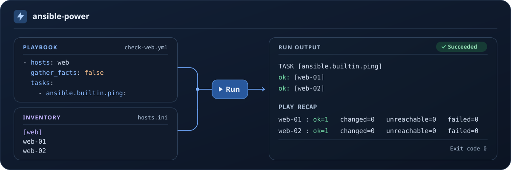
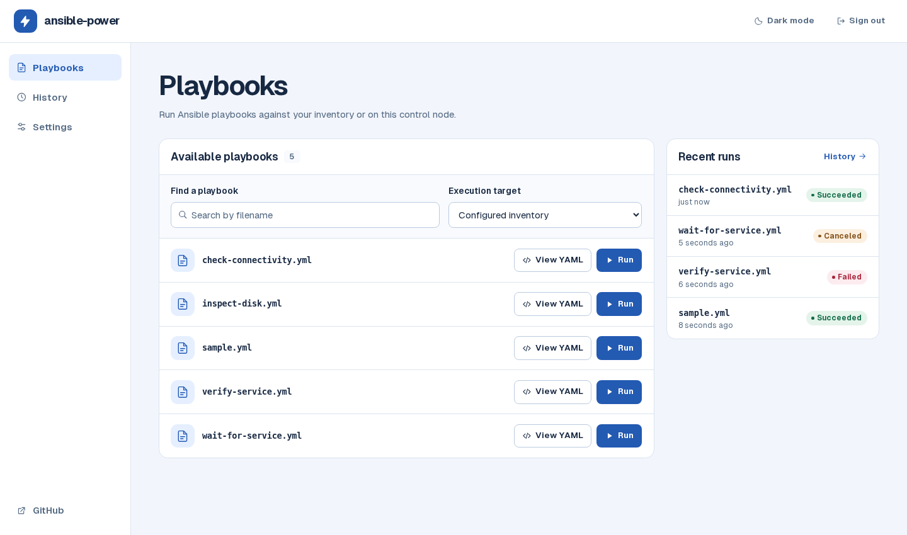
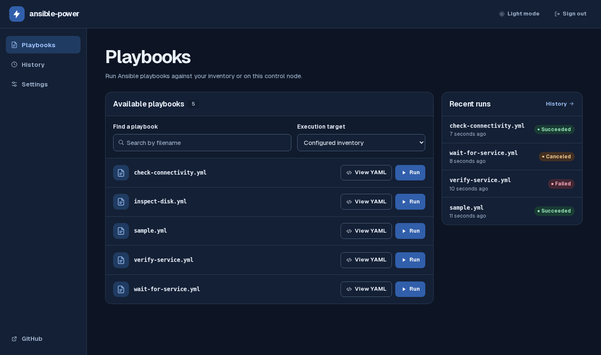

<h1 align="center">ansible-power</h1>

<p align="center">A lightweight, self-hosted web UI for running Ansible playbooks.</p>

<p align="center">
  <a href="https://github.com/pooyanazad/ansible-power/actions/workflows/test.yml"></a>
  <a href="LICENSE"></a>
</p>

<p align="center">
  
</p>

- Browse and run the playbooks in your existing Ansible project.
- Follow live output, cancel runs, and review recorded outcomes in History.
- Edit your inventory and monitor CPU and memory from Settings.
- Export run history as JSON or CSV, and restore it from a JSON export.

## Quick start

### Docker Compose

```bash
git clone https://github.com/pooyanazad/ansible-power.git
cd ansible-power
cp .env.example .env
docker compose up -d --build
docker compose exec ansible-power flask --app ansiblePower create-admin
```

Choose a username and a password of at least 12 characters, then sign in at
[http://localhost:5000](http://localhost:5000). Compose starts the web server and
runner together. Playbooks, inventories, credentials, and run history are stored
in bind-mounted directories on the host. [Docker configuration and upgrade steps](docs/operations.md#docker-deployments)

### Python on Linux

Use Python 3.12 to match the Docker image and CI.

```bash
git clone https://github.com/pooyanazad/ansible-power.git
cd ansible-power
python3.12 -m venv venv
source venv/bin/activate
python -m pip install -r requirements.txt
flask --app ansiblePower create-admin
python ansiblePower.py
```

In another terminal, start the runner from the same checkout and virtual environment.

```bash
source venv/bin/activate
python worker.py
```

Sign in at [http://localhost:5000](http://localhost:5000). The web server accepts
requests and the runner executes queued playbooks using `ansible-playbook`.

## Run a playbook

1. Place your `.yml` or `.yaml` playbooks in `playbooks/`.
2. Open **Settings** and add hosts to the default inventory, `data/inventories/hosts`,
   or select an existing INI or YAML inventory under `data/inventories/`.
3. On **Playbooks**, choose an execution target, click **Run**, and confirm.
   Open the run page to follow output. You can return to it under **Recent runs**.

To try the bundled `sample.yml` without remote hosts, choose **Local — this control node**.
Local mode runs inside the container when using Docker. For **Configured inventory**,
a missing, invalid, or empty inventory blocks the run until you fix it in Settings.

## Screenshots

| Light mode | Dark mode |
| --- | --- |
|  |  |

## Operations and development

- [Operations guide](docs/operations.md) covers deployment, inventory migration,
  backups, cancellation, and run outcomes.
- [Contributing guide](CONTRIBUTING.md) covers development setup and the pull
  request workflow.
- [Issue tracker](https://github.com/pooyanazad/ansible-power/issues) is the place
  to report bugs and request features.

## License

[MIT](LICENSE)
